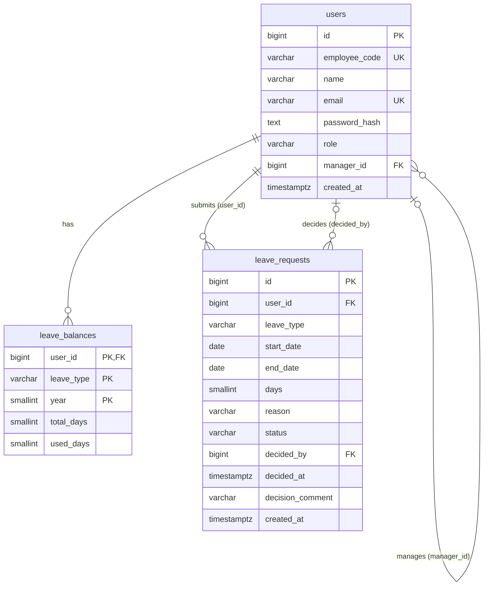

# Leave Management MVP: Design

Source of truth: `SPEC.md`. This document decides **how**, not **what**. Where SPEC is silent, the choice
is recorded in §10 Decisions. Items still marked *(proposed)* are local choices without a decision entry.
§9 lists only items that are still open.

Stack (from SPEC): React + Vite (plain JS) · FastAPI · PostgreSQL.
Library choices *(proposed)*: SQLAlchemy 2.0 (sync) + psycopg 3, Alembic, pydantic-settings, pwdlib[argon2],
PyJWT, pytest + httpx; react-router-dom v6 on the frontend. PostgreSQL ≥ 13 (needed so `btree_gist` is a trusted extension).

Out of scope for this design: deployment (hosting, TLS, process manager, DB provisioning) is decided later.

---

## 1. Architecture overview

### 1.1 Components and request flow

```
Browser (React SPA)
  └─ api/client.js  ── fetch + "Authorization: Bearer <jwt>" ──▶ FastAPI
                                                                 ├─ routers/*      (HTTP in/out only)
                                                                 ├─ routers/deps.py (get_db, get_current_user, require_manager)
                                                                 ├─ services/*     (rules, transactions, locks)
                                                                 ├─ models/*       (SQLAlchemy tables)
                                                                 └─ db/session.py  ──▶ PostgreSQL
```

1. The router validates the body/query with a Pydantic schema. Field-level failures become 422 `VALIDATION_ERROR`.
2. Dependencies resolve the DB session and the current user (JWT → `users` row). Role gates return 401/403.
3. The router calls **one** service function.
4. The service runs on the transaction that is already open (see *Transaction convention* below), takes its
   locks, applies the rules, writes, calls `commit()` once at the end, and returns ORM objects or DTOs.
5. On a rule failure the service raises `AppError(status, code, message)`. A global handler renders `{ "code", "message" }`.
6. The router maps the result to a response schema.

**Transaction convention**

- `get_db` yields one `Session` per request from `SessionLocal(expire_on_commit=False)`. FastAPI caches the
  dependency per request, so `get_current_user`, `require_manager` and the router share that session.
- `get_current_user` loads the user with a `SELECT`. SQLAlchemy auto-begins the transaction on that statement.
  On public routes (`/auth/*`, `/health`) the transaction auto-begins on the service's first statement.
- Services **never** call `session.begin()`. They run on the open transaction and call `session.commit()`
  exactly once, as their last step. Read-only services do not commit.
- `get_db` wraps the `yield` in `try/except`: on **any** exception (including `AppError`) it calls
  `rollback()` and re-raises. It always calls `close()`, which also rolls back an uncommitted read-only transaction.
- After an `IntegrityError` the service issues no further statements. It maps the SQLSTATE to `AppError` and raises;
  `get_db` rolls back.
- `expire_on_commit=False` keeps loaded attributes readable after `commit()`, so the router can build the
  response schema without a lazy reload.
- READ COMMITTED gives every statement a fresh snapshot, so the user `SELECT` before the service's locks does
  not make later reads stale.
- `scripts/seed.py` and `app/cli.py` open their own `SessionLocal()` and follow the same rule: one `commit()` at the end.

### 1.2 Backend layout

```
backend/
  app/
    main.py                  # app factory, CORS, routers, exception handlers
    core/config.py           # Settings (env vars, §6.4)
    core/constants.py        # ENTITLEMENTS = {"EARNED": 12, "SICK": 10}, COMPANY_TZ = "Asia/Kolkata", JWT_EXPIRE_MINUTES = 60
    core/time.py             # company_today(), current_year(): the only source of "today"
    core/security.py         # hash_password, verify_password, create_access_token, decode_access_token
    core/errors.py           # AppError, error code constants, exception handlers (incl. RequestValidationError)
    db/session.py            # engine, SessionLocal (expire_on_commit=False)
    db/base.py               # DeclarativeBase
    models/user.py, leave_balance.py, leave_request.py
    schemas/auth.py, user.py, balance.py, leave_request.py, error.py
    services/working_days.py         # count_working_days
    services/auth_service.py         # signup, authenticate
    services/balance_service.py      # ensure_balance_rows, lock_balance, pending_days, get_balance_summary
    services/leave_request_service.py# validate_dates, submit_request, cancel_request, list_own_requests, get_request_for_viewer
    services/approval_service.py     # approve_request, reject_request, list_manager_requests
    routers/deps.py, auth.py, me.py, balances.py, leave_requests.py, manager.py, health.py
    cli.py                   # `python -m app.cli ensure-balances [--year YYYY]`
  alembic/ (env.py, versions/0001_initial.py, 0002_manager_hierarchy.py)   # hand-written
  scripts/seed.py            # `python -m scripts.seed`
  tests/ unit/ api/ concurrency/ conftest.py
  requirements.txt, .env.example
frontend/
  src/main.jsx, App.jsx      # router + route guards
  src/api/client.js          # fetch wrapper; throws ApiError{status, code, message}
  src/api/endpoints.js       # one function per endpoint
  src/auth/AuthContext.jsx   # token, user, login(), logout(); RequireAuth, RequireManager
  src/pages/                 # LoginPage, SignupPage, DashboardPage, NewRequestPage, MyRequestsPage,
                             # RequestDetailPage, MyLeavePage, ManagerQueuePage, ManagerHistoryPage
  src/components/            # NavBar, BalanceCards, LeaveRequestForm, RequestsTable, StatusBadge,
                             # DecisionDialog, ErrorBanner
  src/utils/workingDays.js   # client-side preview count only (server is authoritative)
  .env.example               # VITE_API_BASE_URL
```

### 1.3 What each layer may do

| Layer | Allowed | Not allowed |
|---|---|---|
| routers | Parse input via schemas, call deps, call one service function, build the response schema | Business logic, queries, commit/rollback |
| routers/deps | `get_db` (yield session, rollback on any exception, close); decode JWT, load user, role gate (`require_manager`) | Business rules (ownership, status), commit |
| services | All business rules, row and advisory locks, one `commit()` at the end, raising `AppError`, mapping `IntegrityError` (SQLSTATE) to `AppError` | `session.begin()`, rollback, importing FastAPI `Request`/`Response`, returning HTTP objects |
| models | Columns, constraints, relationships | Logic |
| schemas | Shape, types, lengths (e.g. `reason ≤ 500`), `extra="ignore"` | Cross-field business rules (date rules live in the service so they get their specific codes) |
| core | Config, constants, time, security, error types | DB access |
| FE pages | Compose components, call `api/endpoints.js`, own page state | Raw `fetch` |
| FE components | Render from props, emit events | Fetching data |
| FE api client | Only place that calls `fetch`; attaches token; on 401 clears token and redirects to `/login`, **except** for `/auth/login` and `/auth/signup`, whose errors (incl. 401 `INVALID_CREDENTIALS`) are thrown to the page and shown inline | UI |
| FE AuthContext | Hold token + `/me` user; expose role | API calls other than login and `/me` |

---

## 2. Data model

Enums are stored as `VARCHAR` + `CHECK`, not as PG ENUM, so migrations stay simple. Values are uppercase
(`PENDING`, `EARNED`, …) in DB and API. The UI shows them in title case.

### 2.1 Tables

**users**

| Column | Type | Constraints |
|---|---|---|
| id | BIGINT identity | PK |
| employee_code | VARCHAR(16) | NOT NULL, UNIQUE; `EMP-0001` from sequence `employee_code_seq` |
| name | VARCHAR(100) | NOT NULL |
| email | VARCHAR(254) | NOT NULL, UNIQUE, `CHECK (email = lower(email))` *(proposed backstop)* |
| password_hash | TEXT | NOT NULL (Argon2) |
| role | VARCHAR(16) | NOT NULL DEFAULT 'EMPLOYEE', `CHECK (role IN ('EMPLOYEE','MANAGER'))` |
| manager_id | BIGINT | NULL, FK → users.id `ON DELETE SET NULL` (`fk_users_manager_id`), `CHECK (manager_id <> id)` (`ck_users_manager_not_self`). Added by migration 0002 |
| created_at | TIMESTAMPTZ | NOT NULL DEFAULT now() |

A MANAGER with `manager_id` NULL is the **super manager**; there is no extra role. Existing rows get NULL
when 0002 runs, and the seed assigns the hierarchy. The `User.manager` relationship is joined-loaded so
`manager_name` needs no lazy load after the session closes.

**leave_balances**

| Column | Type | Constraints |
|---|---|---|
| user_id | BIGINT | NOT NULL, FK → users.id |
| leave_type | VARCHAR(8) | NOT NULL, `CHECK (leave_type IN ('EARNED','SICK'))` |
| year | SMALLINT | NOT NULL |
| total_days | SMALLINT | NOT NULL (value from `ENTITLEMENTS`) |
| used_days | SMALLINT | NOT NULL DEFAULT 0 |
| — | — | PK (user_id, leave_type, year), which gives the SPEC unique key |
| — | — | `ck_leave_balances_used_range CHECK (used_days >= 0 AND used_days <= total_days)` |

**leave_requests**

| Column | Type | Constraints |
|---|---|---|
| id | BIGINT identity | PK |
| user_id | BIGINT | NOT NULL, FK → users.id |
| leave_type | VARCHAR(8) | NOT NULL, CHECK in ('EARNED','SICK') |
| start_date, end_date | DATE | NOT NULL |
| days | SMALLINT | NOT NULL |
| reason | VARCHAR(500) | NULL |
| status | VARCHAR(16) | NOT NULL DEFAULT 'PENDING', CHECK in ('PENDING','APPROVED','REJECTED','CANCELLED') |
| decided_by | BIGINT | NULL, FK → users.id |
| decided_at | TIMESTAMPTZ | NULL |
| decision_comment | VARCHAR(500) | NULL (length: Q9) |
| created_at | TIMESTAMPTZ | NOT NULL DEFAULT now() |

Constraints and indexes on `leave_requests`:

```sql
CONSTRAINT ck_leave_requests_dates     CHECK (end_date >= start_date),
CONSTRAINT ck_leave_requests_days      CHECK (days > 0),
CONSTRAINT ck_leave_requests_not_self  CHECK (decided_by <> user_id),   -- NULL decided_by passes
CONSTRAINT ex_leave_requests_no_overlap EXCLUDE USING gist (
    user_id WITH =,
    daterange(start_date, end_date, '[]') WITH &&
) WHERE (status IN ('PENDING','APPROVED'));

CREATE INDEX ix_leave_requests_user_status ON leave_requests (user_id, status);
CREATE INDEX ix_leave_requests_status      ON leave_requests (status);
CREATE INDEX ix_leave_requests_dates       ON leave_requests (start_date, end_date);
```

SQLSTATE mapping in services: `23P01` (exclusion) → 409 `OVERLAPPING_REQUEST`; `23514` on
`ck_leave_balances_used_range` → 409 `INSUFFICIENT_BALANCE`. Any other integrity error → 500.

### 2.2 ER diagram



### 2.3 Migration notes

- **Hand-written** Alembic revisions `0001_initial` and `0002_manager_hierarchy` (adds `users.manager_id`, its FK and CHECK; downgrade drops them). Autogenerate cannot emit `EXCLUDE` constraints.
- Its first statement is `op.execute("CREATE EXTENSION IF NOT EXISTS btree_gist")`. `btree_gist` is trusted on
  PG ≥ 13, so the DB owner can create it without superuser.
- The exclusion constraint is added with `op.execute(...)` using the SQL above. The CHECKs use `op.create_check_constraint`
  or inline `sa.CheckConstraint` with the names above, so tests can assert on them.
- Create `employee_code_seq` with `op.execute("CREATE SEQUENCE employee_code_seq")`.
- `alembic/env.py` sets `include_object` to skip `ex_leave_requests_no_overlap`, so a later autogenerate does not try to drop it.
- Downgrade drops tables, then the sequence. The extension stays.
- Tests run `alembic upgrade head` on `TEST_DATABASE_URL`. `metadata.create_all` is never used, because it would miss the constraint.

---

## 3. Business rules

| # | Rule | Enforced in | Tests |
|---|---|---|---|
| R1 | Entitlements 12 Earned / 10 Sick come from `ENTITLEMENTS` only | `balance_service.ensure_balance_rows` (the only writer of `total_days`) | A1, B2, E1 |
| R2 | Current-year rows created lazily on `GET /balances`, at signup, at seed, by the CLI, and before locking in submit/approve (`INSERT … ON CONFLICT DO NOTHING`) | `balance_service.ensure_balance_rows`, `get_balance_summary` | A1, B2, E1 |
| R3 | `pending = SUM(days)` of the user's PENDING requests for type/year (year = `start_date` year); `available = total − used − pending`; nothing stored except `used` | `balance_service.pending_days`, `get_balance_summary` | B1, S3, C4 |
| R4 | `days` = count of Mon–Fri dates in `[start, end]` inclusive; holidays ignored | `working_days.count_working_days` | U1–U4 |
| R5 | `end < start` → 422 `INVALID_DATE_RANGE` | `leave_request_service.validate_dates` | U5, S8 |
| R6 | Zero working days → 422 `NO_WORKING_DAYS` | `validate_dates` | U2, U6 |
| R7 | Range spans two calendar years → 422 `SPANS_MULTIPLE_YEARS` | `validate_dates` | U7, S8 |
| R8 | Dates not in the current company-TZ year → 422 `NOT_CURRENT_YEAR`; backdating within the year is allowed | `validate_dates` + `core.time.current_year` | U8, U10, U11, S8 |
| R9 | Overlap with own PENDING/APPROVED request of any type → 409 `OVERLAPPING_REQUEST` (app check plus DB exclusion backstop) | `submit_request` | S4–S6, D2, X4, X5 |
| R10 | `days > available` → 409 `INSUFFICIENT_BALANCE` (pending is reserved) | `submit_request` | S2, S3, X3 |
| R11 | Validation runs R5→R10 in order; the first failure wins | `validate_dates`, then `submit_request` | U9, S10 |
| R12 | REJECTED/CANCELLED never block a new request | `submit_request` overlap query + partial exclusion | S7 |
| R13 | Cancel: requester only (403 `FORBIDDEN`), PENDING only (409 `ALREADY_ACTIONED`) | `cancel_request` | C1–C3, X6 |
| R14 | Approve/reject: managers only → 403 `FORBIDDEN` | `deps.require_manager` | P3 |
| R15 | No self-action → 403 `SELF_ACTION_FORBIDDEN`, checked **before** status; DB CHECK backstop | `approval_service.approve_request` / `reject_request` | P4, P5, D3 |
| R16 | Only PENDING is actionable; first action wins → 409 `ALREADY_ACTIONED`; APPROVED/REJECTED/CANCELLED are terminal | `approve_request`, `reject_request`, `cancel_request` | P6, C3, X1, X6, X7 |
| R17 | Approve re-checks `used + days ≤ total` → 409 `INSUFFICIENT_BALANCE`, then `used += days` (DB CHECK backstop) | `approve_request` | P1, P8, D1, X2 |
| R18 | Reject requires a non-blank comment → 422 `COMMENT_REQUIRED`; approve comment optional | `reject_request` | P2, P7 |
| R19 | Manager list never returns the caller's own requests or a manager's request the caller is not the manager of; the PENDING queue is oldest first and carries `employee_available` | `approval_service.list_manager_requests` | V1, V2, H6, H7 |
| R20 | Request detail: owner or any manager; others 403 `FORBIDDEN` | `leave_request_service.get_request_for_viewer` | V3 |
| R21 | Signup: join code must equal `SIGNUP_CODE` (generic error otherwise), password ≥ 8, email lowercased, role forced to EMPLOYEE, `employee_code` generated, balances created | `auth_service.signup` | A1–A6 |
| R22 | Login lowercases email; JWT valid for 60 min | `auth_service.authenticate`, `security.create_access_token` | A5, A7, U12 |
| R23 | Managers exist only via the seed; the seed is idempotent and sets `manager_id` on new and existing users | `scripts/seed.py` | E1, E2, E3 |
| R25 | A manager's request can be decided only by the requester's `manager_id` → 403 `NOT_REQUESTERS_MANAGER`, after the self check and before the status check. Employee requests stay open to any manager. A manager with no manager has no deciders | `approval_service._lock_for_decision`, `can_decide` | H1–H5 |
| R26 | A MANAGER with `manager_id` NULL (the super manager) cannot submit → 403 `MANAGER_HAS_NO_MANAGER`, before date validation | `submit_request` | H8 |
| R27 | Signup sets `manager_id` to a random MANAGER that has a manager (`auth_service.choose_manager_id`, replaceable in tests), else NULL; `manager_name` is in `UserOut` | `auth_service.signup`, `schemas.user.UserOut` | H9, H10 |
| R24 | "Today"/"current year" come only from `Asia/Kolkata` via one helper | `core.time.company_today` | U11 |

---

## 4. Transactions and locking

Isolation is READ COMMITTED (PG default). Each step after a lock is a **separate statement**, so it sees
rows committed while the transaction waited. Per §1.1, the transaction is already open when the service starts
(auto-begun by `get_current_user`); the service calls `commit()` once at the end, and `get_db` rolls back on
any exception, including `AppError`.

**Global lock order: advisory(user) → request row → balance row.** Each transaction takes its locks in that
order and skips the ones it does not need:

| Txn | Lock order |
|---|---|
| Submit | advisory(user) → balance |
| Approve / Reject | request → balance |
| Cancel | request |

### 4.1 Submit — `submit_request`

| # | Step | Locks | Failure → response |
|---|---|---|---|
| 0 | Schema validation (types, `reason ≤ 500`, `leave_type`) | none | 422 `VALIDATION_ERROR` |
| 1 | `validate_dates` (R5–R8, in order); compute `days`, `year` | none | 422 `INVALID_DATE_RANGE` / `NO_WORKING_DAYS` / `SPANS_MULTIPLE_YEARS` / `NOT_CURRENT_YEAR` |
| 2 | Transaction already open; `SELECT pg_advisory_xact_lock(:user_id)` | advisory(U) | — |
| 3 | `INSERT INTO leave_balances … ON CONFLICT DO NOTHING` | — | — |
| 4 | `SELECT … FROM leave_balances WHERE (user, type, year) FOR UPDATE` | balance(U,T,Y) | — |
| 5 | Overlap: any own PENDING/APPROVED with `daterange(...) && daterange(:s,:e,'[]')` | | 409 `OVERLAPPING_REQUEST` |
| 6 | `available = total − used − pending_days(U,T,Y)`; `days > available` | | 409 `INSUFFICIENT_BALANCE` |
| 7 | INSERT request (PENDING) | new row | `23P01` → 409 `OVERLAPPING_REQUEST` (backstop) |
| 8 | `commit()` → 201 | release all | |

The advisory lock serializes **all** submits by one user, across both leave types. The second submit waits at
step 2, then sees the first one's committed row in steps 5 and 6. So same-type and cross-type races (X3–X5) are
both decided by the app checks.

Why keep the other guards:

- The balance lock is still needed, because approve changes `used_days` on that row without taking the advisory lock.
- The exclusion constraint and the `23P01` → 409 `OVERLAPPING_REQUEST` mapping stay as a backstop. They catch
  any write path that skips the advisory lock (direct SQL, a future code path). They are tested by D2.
- `pg_advisory_xact_lock` is released automatically at commit or rollback. It is the only advisory lock in the
  app, so the bare `user_id` key cannot collide with another use.

Without the advisory lock, two cross-type submits could both insert overlapping rows at once. Each exclusion
check would then wait on the other's uncommitted row, and PG would abort one with `40P01` (deadlock) → 500.

### 4.2 Approve — `approve_request`

| # | Step | Locks | Failure → response |
|---|---|---|---|
| 0 | `require_manager` | none | 401 / 403 `FORBIDDEN` |
| 1 | Transaction already open; `SELECT … FROM leave_requests WHERE id = :id FOR UPDATE` | request R | 404 `NOT_FOUND` |
| 2 | ensure, then `SELECT … FOR UPDATE` balance(R.user, R.type, year(R.start_date)) | balance | — |
| 3 | `caller.id == R.user_id` | | 403 `SELF_ACTION_FORBIDDEN` |
| 3b | `R.requester.role == MANAGER and R.requester.manager_id != caller.id` | | 403 `NOT_REQUESTERS_MANAGER` |
| 4 | `R.status != PENDING` | | 409 `ALREADY_ACTIONED` |
| 5 | `used + R.days > total` | | 409 `INSUFFICIENT_BALANCE` |
| 6 | `UPDATE leave_balances SET used_days = used_days + :days`; `UPDATE leave_requests SET status='APPROVED', decided_by, decided_at=now(), decision_comment` | | `23514` → 409 `INSUFFICIENT_BALANCE` |
| 7 | `commit()` → 200 (request) | release | |

### 4.3 Reject — `reject_request`

Steps 0–4 are the same as approve. SPEC §7 step 1 locks the balance row for the whole approval transaction,
so reject takes the same locks; see Q4. Then:

| # | Step | Failure → response |
|---|---|---|
| 5 | `comment` is null or blank after `strip()` | 422 `COMMENT_REQUIRED` |
| 6 | UPDATE request: REJECTED, decided_by, decided_at, decision_comment (balance unchanged) | — |
| 7 | `commit()` → 200 | |

### 4.4 Cancel — `cancel_request`

| # | Step | Locks | Failure → response |
|---|---|---|---|
| 1 | Transaction already open; `SELECT … FOR UPDATE` request R | request R | 404 `NOT_FOUND` |
| 2 | `caller.id != R.user_id` | | 403 `FORBIDDEN` |
| 3 | `R.status != PENDING` | | 409 `ALREADY_ACTIONED` |
| 4 | UPDATE status = CANCELLED (`decided_by` stays NULL, because the CHECK forbids the requester there; see Q3) | | |
| 5 | `commit()` → 200 | release | |

There is no balance lock, because pending is computed and the reservation disappears with the status change.

### 4.5 Why this cannot deadlock

| Txn | Lock sequence |
|---|---|
| Submit | advisory(U) → balance(U,T,Y) → insert new request row |
| Approve / Reject | request R → balance(U,T,Y) |
| Cancel | request R |

A deadlock needs a cycle: A holds X and waits for Y while B holds Y and waits for X. Every transaction takes
its locks in the global order advisory → request → balance, so no such cycle can form:

- **Advisory locks** are taken only by submit, and always first. A submit waiting on one holds no other lock.
  Approve, reject and cancel never take one, so they never wait on a submit's advisory lock.
- **Request-row locks** are taken only by approve, reject and cancel. Submit never locks an existing request
  row; it only inserts a new one, which no other transaction can see or lock before commit.
- **Balance-row locks** are always taken last. A transaction holding one waits for nothing further, except a
  submit's insert into the exclusion index. That insert could only wait on another submit by the **same user**,
  and the advisory lock rules that out, so it waits only on direct writes outside the service layer.
- `INSERT … ON CONFLICT DO NOTHING` on the balance row (ensure step) can wait on another transaction's
  uncommitted insert of the same key. That is the balance position in the order, so it adds no cycle.

This order is compatible with SPEC's "request row first, then balance row"; the advisory lock only comes before both.
The races are resolved this way:

| Race | Resolution |
|---|---|
| Same request approved twice | Both managers wait on R's lock; the second re-reads R as APPROVED → 409 `ALREADY_ACTIONED` |
| Approve vs cancel | Same, via R's lock |
| Two submits, same type | Serialized by the advisory lock; the second sees the first as pending → 409 `INSUFFICIENT_BALANCE` if it no longer fits |
| Two submits, overlapping, any type | Serialized by the advisory lock; the second fails the step-5 overlap check → 409 `OVERLAPPING_REQUEST`. The exclusion constraint (`23P01` → 409) stays as a backstop |

---

## 5. API reference

All bodies are JSON. Every error has the shape `{ "code": "...", "message": "..." }`. Auth is `Authorization: Bearer <jwt>`
except on the three public routes (`/auth/signup`, `/auth/login`, `/health`). Every authenticated route can return 401 `UNAUTHENTICATED`.

**Shared shapes**

- `UserOut` = `{ id, employee_code, name, email, role }`
- `LeaveRequestOut` = `{ id, user_id, requester_name, requester_employee_code, leave_type, start_date, end_date, days, reason, status, decided_by, decided_by_name, decided_at, decision_comment, created_at }`
- `BalanceOut` = `{ leave_type, entitlement, used, pending, available }`

| Method & path | Role | Request | 2xx response | Errors |
|---|---|---|---|---|
| `GET /health` | public (no auth) | — | 200 `{ "status": "ok" }` after running `SELECT 1` | 503 `DB_UNAVAILABLE` if `SELECT 1` fails *(proposed)* |
| `POST /auth/signup` | public | `{ name, email, password, join_code }` (any `role` is ignored) | 201 `{ access_token, token_type:"bearer", expires_in:3600, user: UserOut }` | 400 `SIGNUP_FAILED` (wrong or missing code; generic), 409 `EMAIL_ALREADY_REGISTERED`, 422 `VALIDATION_ERROR` |
| `POST /auth/login` | public | `{ email, password }` | 200, same shape as signup | 401 `INVALID_CREDENTIALS`, 422 |
| `GET /me` | any | — | 200 `UserOut` (`id, employee_code, name, email, role, manager_name`; `manager_name` is null without a manager) | 401 |
| `GET /balances` | any | — | 200 `{ year, balances: [BalanceOut ×2] }` (creates missing rows) | 401 |
| `POST /leave-requests` | any except the super manager | `{ leave_type, start_date, end_date, reason? }` | 201 `LeaveRequestOut` | 403 `MANAGER_HAS_NO_MANAGER`; 422 `VALIDATION_ERROR`/`INVALID_DATE_RANGE`/`NO_WORKING_DAYS`/`SPANS_MULTIPLE_YEARS`/`NOT_CURRENT_YEAR`; 409 `OVERLAPPING_REQUEST`/`INSUFFICIENT_BALANCE` |
| `GET /leave-requests?status=` | any | optional status | 200 `[LeaveRequestOut]`, own only, `created_at` desc | 422 bad status |
| `GET /leave-requests/{id}` | owner or any manager | — | 200 `LeaveRequestOut` | 403 `FORBIDDEN`, 404 `NOT_FOUND` |
| `POST /leave-requests/{id}/cancel` | requester | — | 200 `LeaveRequestOut` | 403 `FORBIDDEN`, 404, 409 `ALREADY_ACTIONED` |
| `POST /leave-requests/{id}/approve` | manager ≠ requester (a manager's request: only their manager) | `{ comment? }` | 200 `LeaveRequestOut` | 403 `FORBIDDEN`/`SELF_ACTION_FORBIDDEN`/`NOT_REQUESTERS_MANAGER`, 404, 409 `ALREADY_ACTIONED`/`INSUFFICIENT_BALANCE` |
| `POST /leave-requests/{id}/reject` | manager ≠ requester (a manager's request: only their manager) | `{ comment }` | 200 `LeaveRequestOut` | 403 `FORBIDDEN`/`SELF_ACTION_FORBIDDEN`/`NOT_REQUESTERS_MANAGER`, 404, 409 `ALREADY_ACTIONED`, 422 `COMMENT_REQUIRED` |
| `GET /manager/requests?status=` | manager | optional status (omitted = all) | 200 `[LeaveRequestOut + employee_available]`, excluding the caller's own and manager requests the caller is not the manager of; PENDING sorted by `created_at` asc, otherwise `created_at` desc; `employee_available` set on PENDING rows, null otherwise | 403 `FORBIDDEN` |

`employee_available` = `available` for (requester, request type, request year), using the R3 formula.

The 401/404/`FORBIDDEN`/`VALIDATION_ERROR`/`SIGNUP_FAILED`/`EMAIL_ALREADY_REGISTERED`/`INVALID_CREDENTIALS`
codes are decided in Q1 and Q2 (§10).

---

## 6. Auth and seeding

### 6.1 JWT flow
1. Login: lowercase the email, load the user, run `verify_password` (pwdlib Argon2). Any mismatch → 401 `INVALID_CREDENTIALS`.
2. Token: HS256 via PyJWT, claims `{ sub: str(user.id), role, iat, exp = iat + 60 min }`, signed with `SECRET_KEY`.
3. `get_current_user`: decode the token (expired or invalid → 401), then load the user by `sub`. **Role is read from the DB row**; the `role` claim is informational only.
4. `require_manager`: `user.role == 'MANAGER'`, else 403 `FORBIDDEN`.
5. Frontend: the token goes in `localStorage`. On boot, AuthContext calls `/me`. Any 401 clears the token and redirects to `/login`,
   except a 401 from `/auth/login` or `/auth/signup`, which is shown inline on that form. There are no refresh tokens.

### 6.2 Signup (`auth_service.signup`, one transaction)
1. Compare `join_code` to `SIGNUP_CODE` with `hmac.compare_digest`. A mismatch or missing code → 400 `SIGNUP_FAILED`, checked first so callers without the code cannot probe emails.
2. Password length ≥ 8 is checked in the schema → 422.
3. Lowercase the email. If it already exists → 409 `EMAIL_ALREADY_REGISTERED`, with the unique-violation race mapped to the same error.
4. Insert the user with `role='EMPLOYEE'` (the schema has no role field), `employee_code = 'EMP-' + lpad(nextval('employee_code_seq'), 4, '0')` and `manager_id` = `choose_manager_id(...)` over the MANAGERs that have a `manager_id` (never the super manager; NULL when there are none). `choose_manager_id` wraps `random.choice` and is a module-level function so tests replace it.
5. `ensure_balance_rows(user, current_year())` → 12 Earned + 10 Sick.
6. Commit, then return a token and the user.

### 6.3 Seed (`python -m scripts.seed`, run after `alembic upgrade head`)
- Users: `supermanager@` (MANAGER, no manager), `manager1@`, `manager2@` (MANAGER, `Manager@123`) and `employee1–4@example.com` (EMPLOYEE, `Employee@123`).
  Names *(proposed)*: "Super Manager", "Manager One", "Manager Two", "Employee One", and so on.
- Hierarchy: `manager1`, `manager2` → `supermanager`; `employee1`, `employee4` → `manager2`; `employee2`, `employee3` → `manager1`.
- Idempotent: for each user, `SELECT` by email and insert only if missing; new users are appended to the list so existing employee codes do not shift. Existing rows keep their name, role and password (no reset, no sequence value consumed). A second pass, after every seed user exists, sets `manager_id` on **all** seed users, new or existing, so a database seeded before the hierarchy is repaired by the next run.
- Then `ensure_balance_rows` for the current year for **all** users (`ON CONFLICT DO NOTHING`).
- Prints a created/skipped count. A second run reports 0 created.
- `python -m app.cli ensure-balances [--year]` handles year rollover for all users.

### 6.4 Environment variables

| Var | Used by | Notes |
|---|---|---|
| `DATABASE_URL` | backend, Alembic, seed | `postgresql+psycopg://…` |
| `TEST_DATABASE_URL` | tests | separate database |
| `SECRET_KEY` | JWT signing | required; the app refuses to start without it |
| `SIGNUP_CODE` | signup | required; documented in `.env.example` and README, never hard-coded |
| `PASSWORD_HASH_FAST` | `core/security.py` | default `false` (pwdlib Argon2 defaults). `true` = cheap Argon2 parameters (`time_cost=1`, `memory_cost=1024` KiB, `parallelism=1`); set only by the test `conftest.py`, never in production |
| `CORS_ORIGINS` | backend | comma-separated; default `http://localhost:5173` |
| `VITE_API_BASE_URL` | frontend | default `http://localhost:8000` |

These are constants, not env vars: `ENTITLEMENTS`, `COMPANY_TZ="Asia/Kolkata"`, `JWT_EXPIRE_MINUTES=60`, `JWT_ALG="HS256"`.

---

## 7. Frontend

| Route | Who | Screen | API calls |
|---|---|---|---|
| `/login` | public | Email/password form; errors (401 `INVALID_CREDENTIALS`, 422) shown inline, no redirect | `POST /auth/login`, then `GET /me` |
| `/signup` | public | Name, email, password, join code; errors (400 `SIGNUP_FAILED`, 409, 422) shown inline, no redirect | `POST /auth/signup` |
| `/` | any | Redirects: employee → `/dashboard`, manager → `/manager/queue` | — |
| `/dashboard` | any | Earned and Sick cards (entitlement/used/pending/available) | `GET /balances` |
| `/requests/new` | any | Form with live working-day count (`utils/workingDays.js`); server errors shown inline by `code` (date codes on the date fields, others in a banner) | `GET /balances`, `POST /leave-requests` |
| `/requests` | any | Own list with status filter, badges, decision comment, Cancel on PENDING only | `GET /leave-requests?status=`, `POST /leave-requests/{id}/cancel` |
| `/requests/:id` | owner or manager | Detail; Approve/Reject shown only if viewer is a manager, not the owner, and status is PENDING | `GET /leave-requests/{id}`, approve/reject/cancel |
| `/my-leave` | manager | Own balances + new-request form + own requests on one page (reuses the components above) | `GET /balances`, `POST /leave-requests`, `GET /leave-requests` |
| `/manager/queue` | manager | Pending, oldest first: employee (name, code), type, dates, days, `employee_available`, Approve (optional comment) / Reject (comment required) via `DecisionDialog`; the row is removed on success, and on 409 the queue refetches | `GET /manager/requests?status=PENDING`, approve, reject |
| `/manager/history` | manager | All requests except own, status filter only | `GET /manager/requests?status=` |

Nav for employees: Dashboard, New request, My requests. Nav for managers: My leave, Queue, History. The
employee routes stay reachable for managers. `RequireAuth` and `RequireManager` guards are UX only; the
server enforces everything.

`api/client.js` 401 rule: on a 401 from any route it clears the token and redirects to `/login`. The rule does
**not** apply to `POST /auth/login` and `POST /auth/signup`. For those two, the client throws `ApiError` like any
other error, and the page shows it inline. Otherwise a wrong password would reload the login page and hide the message.

---

## 8. Test plan

Infrastructure: pytest runs against real PostgreSQL (`TEST_DATABASE_URL`, `alembic upgrade head` once per
session, `TRUNCATE … RESTART IDENTITY CASCADE` between tests). `core.time.company_today` is monkeypatched
to freeze dates. `conftest.py` sets `PASSWORD_HASH_FAST=true`, so Argon2 uses cheap parameters (§6.4).
Concurrency tests use separate DB sessions in threads behind a `threading.Barrier`, repeat 20×, and are
marked `@pytest.mark.concurrency`.

**Priority.** Every test is **MUST** or **SHOULD**.

- **MUST** covers a rule stated in the client brief (SPEC, esp. §12) or a claim made in the demo: validation,
  balance, overlap, approval, double approval, double submit, cancel-vs-approve.
- **SHOULD** covers everything else (auth details, ordering details, read-only views).
- Build and pass all MUST tests first. Start SHOULD tests only after that.

### 8.1 Unit (`tests/unit`)
| ID | Pri | Test |
|---|---|---|
| U1 | MUST | Mon–Fri = 5 days |
| U2 | MUST | Sat–Sun = 0 |
| U3 | MUST | Single weekday = 1; single Saturday = 0 |
| U4 | MUST | Fri–Mon = 2; Mon–Fri of next week = 10 |
| U5 | MUST | `end < start` → `INVALID_DATE_RANGE` |
| U6 | MUST | Weekend-only → `NO_WORKING_DAYS` |
| U7 | MUST | 2026-12-31 → 2027-01-01 → `SPANS_MULTIPLE_YEARS` |
| U8 | MUST | Last year and next year → `NOT_CURRENT_YEAR` |
| U9 | MUST | First failure wins (e.g. `end<start` and wrong year → `INVALID_DATE_RANGE`; Sat 31 Dec → Sun 1 Jan → `NO_WORKING_DAYS`) |
| U10 | SHOULD | Backdated date earlier this year is accepted |
| U11 | SHOULD | `company_today` at 2026-12-31T19:00Z returns 2027-01-01 (IST) |
| U12 | SHOULD | Password hash round-trip; token `exp − iat = 3600`; expired token is rejected |

### 8.2 API (`tests/api`)
| ID | Pri | Test |
|---|---|---|
| A1 | MUST | Signup creates EMPLOYEE, `EMP-####`, 12/10 rows |
| A2 | MUST | Wrong/missing join code → 400 `SIGNUP_FAILED` (same body for both) |
| A3 | MUST | `role:"MANAGER"` in body is ignored → EMPLOYEE |
| A4 | SHOULD | Password < 8 → 422 |
| A5 | SHOULD | Mixed-case email stored lowercase; login is case-insensitive |
| A6 | SHOULD | Duplicate email → 409 |
| A7 | SHOULD | Bad password → 401; no or expired token → 401 |
| H1 | SHOULD | `GET /health` without a token → 200 `{ "status": "ok" }` |
| B1 | MUST | Balances report entitlement/used/pending/available correctly after a submit and an approve |
| B2 | MUST | `GET /balances` creates missing current-year rows (rows deleted or clock frozen to next year) |
| S1 | MUST | Submit OK; `days` stored; status PENDING |
| S2 | MUST | `days > available` → 409 `INSUFFICIENT_BALANCE` |
| S3 | MUST | Pending reservation counts: 8 pending + 5 new (Earned 12) → 409 |
| S4 / S5 | MUST | Overlap with PENDING / APPROVED → 409 `OVERLAPPING_REQUEST` |
| S6 | MUST | Earned vs Sick overlap → 409 |
| S7 | MUST | Same dates after REJECTED or CANCELLED → 201 |
| S8 | MUST | Year-boundary and out-of-year → correct 422 codes via API |
| S9 | MUST | `reason` > 500 chars → 422 |
| S10 | MUST | Overlapping **and** insufficient → `OVERLAPPING_REQUEST` (order) |
| C1 | MUST | Owner cancels PENDING → CANCELLED |
| C2 | MUST | Other user (employee or manager) cancels → 403 |
| C3 | MUST | Cancel APPROVED/REJECTED/CANCELLED → 409 `ALREADY_ACTIONED` |
| C4 | MUST | Cancel restores `available` |
| P1 | MUST | Approve → APPROVED, `used += days`, `decided_by/at` set, approver name in response |
| P2 | MUST | Reject with comment → REJECTED, balance unchanged |
| P3 | MUST | Employee approve/reject → 403 `FORBIDDEN` |
| P4 | MUST | Manager approve/reject own → 403 `SELF_ACTION_FORBIDDEN` |
| P5 | SHOULD | Own **already-actioned** request → 403 (self check before status) |
| P6 | MUST | Approve/reject already-actioned → 409 `ALREADY_ACTIONED` |
| P7 | MUST | Reject with missing/blank comment → 422 `COMMENT_REQUIRED` |
| P8 | MUST | Forced impossible state (`used_days` set directly to `total − 1`, approve 2 days) → 409 `INSUFFICIENT_BALANCE`, `used_days` unchanged |
| P9 | MUST | The super manager approves/rejects manager1's request → 200; manager2 gets 403 `NOT_REQUESTERS_MANAGER` *(changed in step 7.1; was "manager2 approves manager1's request → 200")* |
| V1 | MUST | Queue excludes caller's own, is oldest first, includes `employee_available` |
| V2 | SHOULD | History status filter works and excludes caller's own |
| V3 | SHOULD | Detail: owner 200, manager 200, other employee 403, missing 404 |
| V4 | SHOULD | Responses include `requester_name`, `requester_employee_code`, `decided_by_name` |
| V5 | SHOULD | `GET /leave-requests?status=` returns only own, filtered |
| D1 | MUST | Direct `UPDATE leave_balances SET used_days = total_days + 1` → CHECK violation |
| D2 | MUST | Direct overlapping PENDING inserts → `23P01` |
| D3 | MUST | Direct `UPDATE leave_requests SET decided_by = user_id` → CHECK violation |
| E1 | MUST | Seed twice → 7 users, codes unchanged, 14 balance rows |
| E2 | MUST | Seeded users can log in; manager role correct |
| E3 | MUST | Seed assigns the hierarchy, is idempotent, and repairs `manager_id` on existing rows |
| D4 | MUST | `users.manager_id`: self-manager CHECK, FK, `ON DELETE SET NULL`; migration 0002 upgrades from 0001 and downgrades |
| H1–H5 | MUST | Super manager decides a manager's request; other managers 403 (before 409, after the self check); employee requests open to any manager |
| H6–H7 | MUST | Queue and history hide manager requests the viewer cannot act on; ordering and fields unchanged |
| H8 | MUST | The super manager cannot submit (403 `MANAGER_HAS_NO_MANAGER`) |
| H9–H10 | MUST | Signup assigns `manager1` or `manager2` (deterministic with the replaced chooser), NULL without candidates; `manager_name` in `/me` |

### 8.3 Concurrency (`tests/concurrency`)
| ID | Pri | Scenario | Expected |
|---|---|---|---|
| X1 | MUST | **Double approval:** manager1 and manager2 approve the same request at once | One 200, one 409 `ALREADY_ACTIONED`; `used_days` incremented once |
| X2 | MUST | Two different requests that both fit are approved at once | Both 200; `used_days` = sum |
| X3 | MUST | **Double submit**, same type, non-overlapping, each fits alone but not together | One 201, one 409 `INSUFFICIENT_BALANCE`; pending ≤ entitlement |
| X4 | MUST | **Double submit**, identical dates | One 201, one 409 `OVERLAPPING_REQUEST` |
| X5 | MUST | **Double submit**, overlapping, Earned vs Sick | One 201, one 409 `OVERLAPPING_REQUEST` (from the step-5 overlap check, after the advisory lock). Must pass on all 20 repeats with **no `40P01` (deadlock) and no 500** |
| X6 | MUST | **Cancel vs approve** on the same request | Exactly one succeeds, the other gets 409 `ALREADY_ACTIONED`; `used_days` matches the final status |
| X7 | SHOULD | Approve vs reject on the same request | Exactly one succeeds, the other gets 409 |

After every X test, assert the invariants: `used ≤ total`, `available ≥ 0`, and no overlapping PENDING/APPROVED rows.
No X test may produce a 500.

---

## 9. Open questions and risks

### 9.1 Open questions

None. Every gap found in SPEC has a decision in §10. Add new open items here.

### 9.2 Risks

| Risk | Mitigation |
|---|---|
| Deadline 20 Oct 2026 17:00 (4 days) | Build order: migration + services + MUST tests → API → FE; SHOULD tests and FE polish last |
| `btree_gist` unavailable or privilege-restricted on the host DB | Require PG ≥ 13; check during setup; fail the migration loudly |
| Alembic autogenerate drops or misses the exclusion constraint | Hand-written migration; `include_object` filter; D2 test |
| Concurrency tests flaky or slow | Barrier + 20 repeats + invariant asserts; separate pytest marker |
| A submit can see an in-flight cancel's row as still pending → spurious `INSUFFICIENT_BALANCE` | Acceptable (conservative); the user retries |
| TZ bugs around IST midnight (server runs in UTC) | Single `company_today()`; U11 |
| JWT in `localStorage` (XSS exposure), no revocation | 60-min expiry; no `dangerouslySetInnerHTML`; documented limitation |
| Shared join code can be brute-forced; no rate limit | Out of MVP scope; `compare_digest`; documented |
| Client working-day preview may diverge from server | Server is authoritative; the form shows the server error inline |
| No pagination on lists | Small org; add later |

---

## 10. Decisions

Gaps and ambiguities in SPEC, resolved. The proposed defaults were accepted as-is. IDs stay `Q#` because
other sections refer to them.

| # | Gap or ambiguity in SPEC | Decision |
|---|---|---|
| Q1 | Error codes/statuses not named in SPEC: unauthenticated, bad login, role violation, not found, generic schema validation | 401 `UNAUTHENTICATED`, 401 `INVALID_CREDENTIALS`, 403 `FORBIDDEN`, 404 `NOT_FOUND`, 422 `VALIDATION_ERROR` |
| Q2 | Signup: the HTTP status of the "generic error" for a wrong code, and how a duplicate email is handled | 400 `SIGNUP_FAILED`; duplicate → 409 `EMAIL_ALREADY_REGISTERED` (checked only after a valid code) |
| Q3 | Cancel: SPEC says only "set Cancelled". `decided_by` cannot be the requester (CHECK). Should `decided_at` record the cancel time? | Leave `decided_by` and `decided_at` NULL |
| Q4 | SPEC §7 step 1 (lock request, then balance) sits in the shared approve/reject transaction; reject does not need the balance lock | Follow SPEC literally: reject also locks the balance (harmless, same order) |
| Q5 | Reject with a blank comment on an already-actioned request: SPEC order gives 409, not 422. Does a whitespace-only comment count as empty? | 409 (SPEC order); blank after `strip()` = empty |
| Q6 | `employee_available` in the queue already subtracts the request under review (it is pending). A manager may read "0 available" as "cannot approve" | Keep the SPEC formula; the UI labels it "Available (after pending)" |
| Q7 | "Oldest first": by submission or by start date? | `created_at` asc |
| Q8 | `GET /manager/requests` with no `status`, and history ordering | All statuses, `created_at` desc |
| Q9 | `decision_comment` max length unspecified | 500 chars, like `reason` |
| Q10 | Signup inputs not listed; `name` is a required column | Signup collects `name` (1–100 chars) |
| Q11 | After rollover, last year's PENDING requests stay actionable and reserve last year's balance, but `GET /balances` shows only the current year | Accept; approve uses `year(start_date)` |
| Q12 | SPEC says "3–4 demo employees" but its table lists 3. Should re-running the seed reset demo passwords? | Seed exactly the 3 listed; never modify existing users |
| Q13 | Detail for a non-owner employee: 403 or 404? | 403 `FORBIDDEN` (SPEC: 403 for role violations) |
| Q14 | Ownership check vs status check order on cancel (SPEC gives only the status check) | Ownership first (403), then status (409), mirroring approve |
